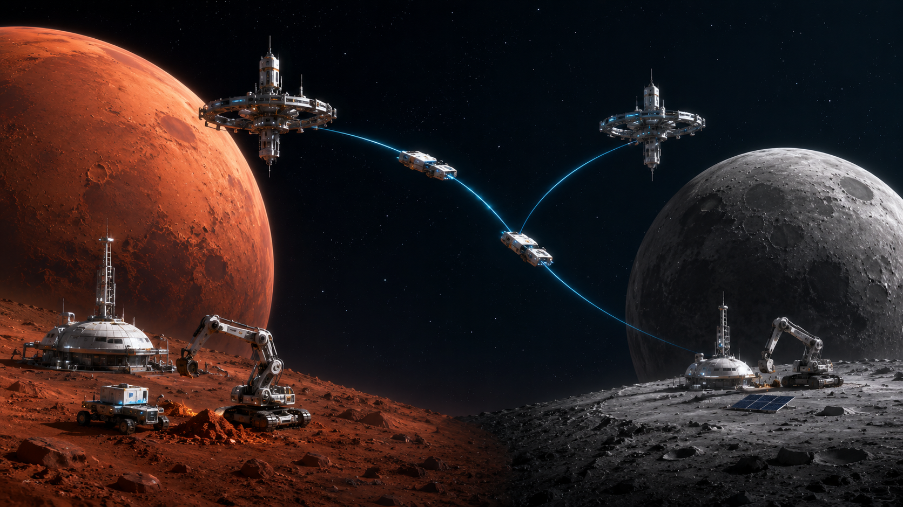

# Space Robotics
A curated collection of resources for those who want to become professionals in Space Robotics (including me).

| Section | Contents |
|---|---|
| [Learning](docs/learning/README.md) | Videos, courses, books, robotics and space fundamentals |
| [Papers](docs/papers/README.md) | Literature by topic, research directions |
| [Datasets](datasets/README.md) | Mars and Moon datasets |
| [Tools](docs/tools/README.md) | Simulators, flight software, data access |
| [Missions & reports](docs/missions-and-reports/README.md) | Agency reports, mission docs, careers |
| [Competitions](docs/competitions.md) | Space Apps, Lunabotics, ERC |
| [`library/`](library/) | Local PDFs (papers, reports, proposals) |
